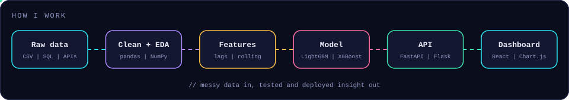

  

  Final-year B.S. student in <b>Data Science &amp; Applications at IIT Madras</b>. 
  I turn messy data into tested models, then ship them as APIs and dashboards people can actually use.

  <a href="https://www.linkedin.com/in/mandeep15">LinkedIn</a> &nbsp;|&nbsp;
  <a href="mailto:mandeepbeniwal.in@gmail.com">Email</a> &nbsp;|&nbsp;
  <a href="https://hotspotholidays.in">hotspotholidays.in (live)</a>

  

---

## About me

Hi, I'm Mandeep. I'm a final-year Data Science student at IIT Madras, and I like taking an idea all the way from raw data to something live on the internet.

The part of ML I care about most is the unglamorous one: checking whether a model is actually any good. In **ArthIQ**, my stock-analysis project, the ML model I built didn't hold up on a test set I had locked away, so I rejected it instead of shipping something that only looked good on paper.

I also build everything around the model. **Hotspot Holidays**, a travel site I built and deployed on my own, is live right now with both a web app and a native mobile app. On **Smart Library**, a team project, I was project manager and backend developer for a team of four.

I'm looking for data science, ML, or software engineering roles where I can keep doing both: find the signal, then ship it.

IIT Madras Diploma in Data Science and Diploma in Programming, plus the Advanced Certificate in Machine Learning and Data Science (CODE).

## Skills

  

<b>Full list</b>

| Area | Tools |
|---|---|
| **Data science and ML** | Python, pandas, NumPy, scikit-learn, LightGBM, XGBoost, time-series forecasting, feature engineering, walk-forward validation, EDA, Rank IC and quintile diagnostics, Platt calibration |
| **Data and SQL** | SQL, PostgreSQL, SQLite, SQLAlchemy, Alembic, Matplotlib, Seaborn, Chart.js |
| **LLM tooling** | Google Gemini API, LangChain tool-calling agents, prompt design, model fallback handling |
| **Backend** | Flask, FastAPI, REST APIs, OpenAPI 3.1 contracts, JWT auth, role-based access control, Redis, Celery |
| **Frontend** | Vue 3, React 19, TypeScript, JavaScript, Tailwind CSS, Bootstrap |
| **Tools and deployment** | Git and GitHub, Docker, Vercel, Capacitor and Ionic, Linux |

## How I work

  

## Featured projects: data science and ML

| Project | What it is | Stack |
|---|---|---|
| **ArthIQ** | Decision-support engine for Nifty 500 stocks. A point-in-time data layer blocks lookahead bias, and a walk-forward backtester evaluates a 24-feature ML pipeline. When the model failed on a frozen 2024-2026 test set (Rank IC, quintile spread, and ablation diagnostics), I rejected it under 8 promotion gates instead of shipping it. | Python, FastAPI, React 19, TypeScript, LightGBM, SQL |
| **Cinema Audience Forecasting** | Time-series ensemble that predicts daily audience counts by joining BookNow and CinePOS data. **Top 17%** in the competition. | Python, LightGBM, XGBoost |
| **Restaurant Rating Prediction** | Kaggle competition on predicting restaurant ratings. **Top 14%.** | Python, scikit-learn |
| **BDM Capstone: harvesting operations** | Cleaned and combined harvest, fuel, and payroll records to measure an informally tracked business (19.31 acres/day average, 3.90 L/acre fuel use). Found that peak-output days had at most one village switch, which led to a scheduling recommendation projected to lift seasonal output by 10-15%. | Python, pandas |
| **TDS Data Analyst Agent** | LLM agent that takes a plain-English question and a dataset, writes and runs the Python analysis in an isolated process, and returns structured results and charts. Includes API-key rotation and a 5-level model fallback. | Gemini, LangChain, FastAPI, pandas, Docker |

## Featured projects: software engineering

| Project | What it is | Stack |
|---|---|---|
| **[Hotspot Holidays](https://hotspotholidays.in)** | Live travel marketplace I built and deployed on my own, with traveler, partner, and admin roles, an admin analytics dashboard, a coupon engine with an audit ledger, and a native Android/iOS app. | Vue 3, TypeScript, Flask, PostgreSQL, Redis, Capacitor/Ionic |
| **Smart Library Management System** | Multi-tenant library platform built by a 4-member Scrum team. I was **project manager and primary backend developer**. 90-operation OpenAPI contract, 176 backend and 55 frontend automated tests. | FastAPI, PostgreSQL, Alembic, Vue 3, Pinia |
| **[Placify](https://github.com/23f2001951/Placement_Portal)** | Campus placement platform for admins, companies, and students, with Celery-scheduled reminders and reports, Redis caching, and an offline-capable PWA. | Flask, Celery, Redis, Vue 3, Chart.js |
| **[ParkEasy](https://github.com/23f2001951/Vehicle_Parking_V1)** | Parking reservation system with automatic spot allocation, an hourly billing engine, and admin revenue reports. | Flask, SQLAlchemy, SQLite, Bootstrap |

## Let's connect

  <a href="https://www.linkedin.com/in/mandeep15"><b>LinkedIn</b></a> &nbsp;|&nbsp;
  <a href="mailto:mandeepbeniwal.in@gmail.com"><b>mandeepbeniwal.in@gmail.com</b></a> &nbsp;|&nbsp;
  <a href="https://hotspotholidays.in"><b>Live project</b></a>

